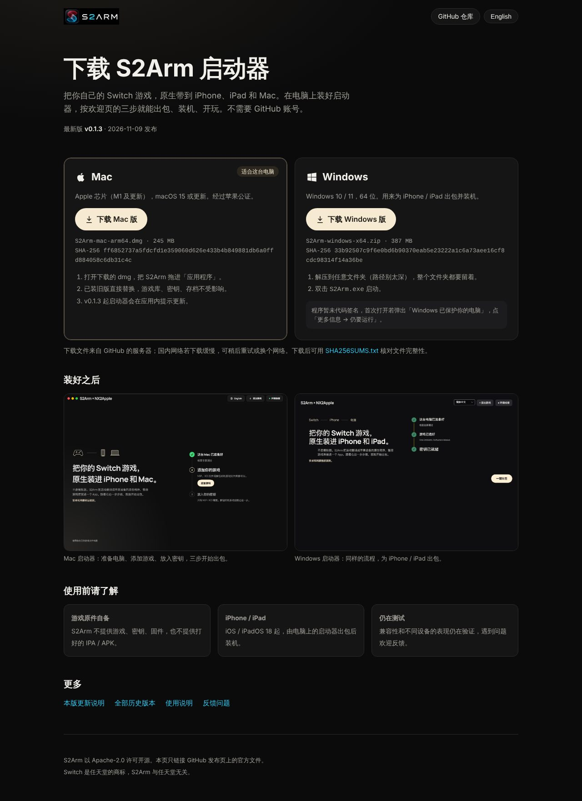
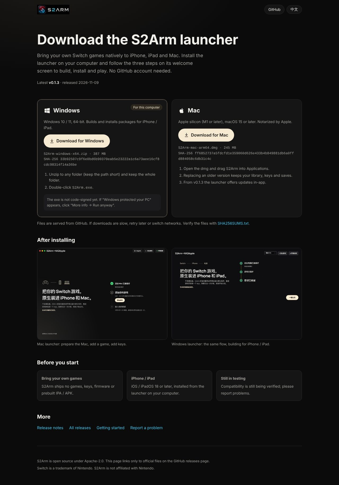
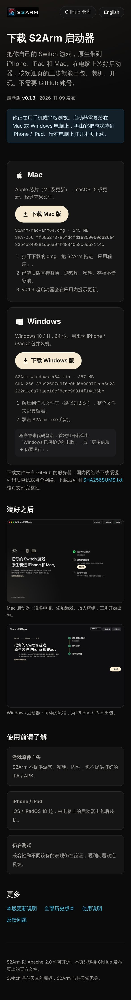

# 下载页（GitHub Pages）

给不用 GitHub 的玩家一个直接下载启动器的页面：<https://jhaizhou-ops.github.io/S2Arm/>。

## 怎么工作

- 页面只有一个文件 [index.html](index.html)，样式和脚本都内联，不引外部资源。
- 两个下载按钮直接指向 `releases/latest/download/<产物名>`，GitHub 自动跳到最新正式版的同名文件。**发版时 Mac / Windows 产物名必须保持 `S2Arm-mac-arm64.dmg`、`S2Arm-windows-x64.zip` 不变**，否则按钮会 404；改名要同步改 `index.html`。Windows 安装程序 `S2Arm-windows-x64-setup.exe`（v0.3.0 起）：页面脚本看最新正式版里有它，就把 Windows 主按钮换成它、压缩包降为「便携版」链接；没有就照旧给压缩包（所以页面可以先于带安装程序的版本发布）。
- `releases/latest` 只认正式版：标成「预发布」的版本不会出现在按钮上。
- 页面脚本调用一次 `api.github.com/repos/jhaizhou-ops/S2Arm/releases/latest`，补上版本号、发布日期、文件大小和 SHA-256。页顶的「点个星」链接到仓库主页（GitHub 不支持站外一键点星，要在仓库页点 Star），脚本再调一次 `api.github.com/repos/jhaizhou-ops/S2Arm` 显示当前 Star 数。接口不通（未登录用户每个 IP 每小时 60 次）时只少这几行字和数字，按钮照常可用；关掉脚本也能下载。
- 发版不用重新发布页面：按钮和版本信息都是访问时现取的。

## 启动器公告（notice.json）

Mac / Windows 启动器顶部的公告条读 [notice.json](notice.json)：启动时从 <https://jhaizhou-ops.github.io/S2Arm/notice.json> 取（取不到用发版时打进包里的同一份，再没有就不显示，不报错），玩家点 × 关掉后同一条不再出现。

- 发新公告：改 `text` 的中英文，**同时换一个新的 `id`**（关掉过旧公告的玩家才会看到新的）。合进 `main` 后 Pages 自动发布，已发出的启动器下次启动就显示，不用发版。
- 撤掉公告：把文件改成 `{"schema": 1}`（没有 `id` / `text` 就不显示）。
- `url` 可选：公告条上「详情」打开的链接，只认 `https` 的 github.com / jhaizhou-ops.github.io。
- 只放一条公告，纯文本，不支持格式。

## 发布

[.github/workflows/pages.yml](../../.github/workflows/pages.yml) 在 `main` 上本目录或用到的图片有改动时，把 `index.html` 和三张图（`docs/images/` 的标志、Mac / Windows 启动器截图，`launchers/macos/Branding/AppIcon-1024.png` 作图标）拷进 `_site/` 发布，不构建、不下载依赖。也可以在 Actions 页手动运行。

首次启用需要仓库管理员做一次：Settings → Pages → Build and deployment → Source 选 **GitHub Actions**；然后在 Actions 页手动运行一次 Pages 工作流。

## 本地预览

```sh
mkdir -p build/site/images
cp docs/site/index.html build/site/
cp docs/images/s2arm-wordmark-transparent.png docs/images/launcher-welcome.png docs/images/launcher-windows.png build/site/images/
cp launchers/macos/Branding/AppIcon-1024.png build/site/images/icon.png
python3 -m http.server -d build/site 8000
```

## 预览

[preview/](preview/) 里是本地用 Chromium 截的整页图，只供审阅和文档引用，不会发布到 Pages：

| Mac（中文） | Windows（英文） | iPhone |
|---|---|---|
|  |  |  |
