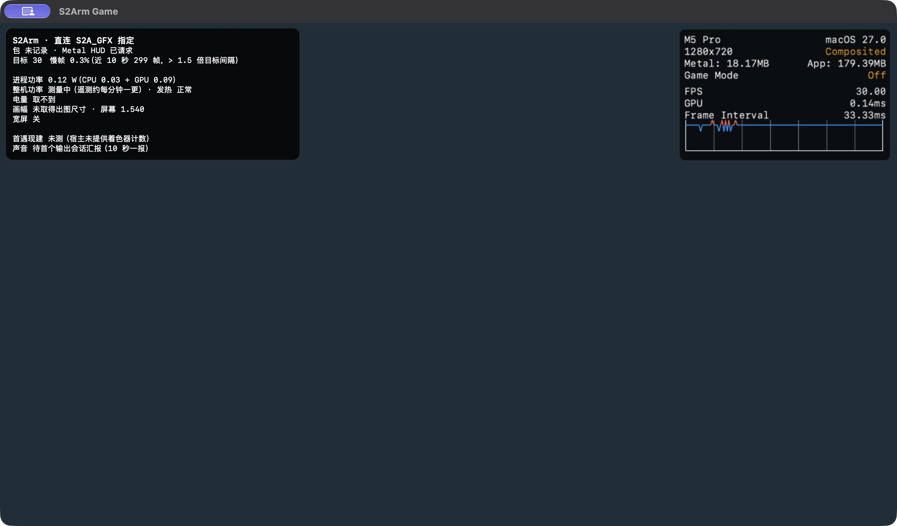

# 开发监控与 Metal HUD

局内监控分为两个默认关闭、可分别开启的入口：Apple Metal HUD 显示标准图形指标，S2Arm 诊断浮层显示项目状态。官方 Metal HUD 只供手动观察；开启时不使用游戏纹理截图 / 存帧、自动玩家和满屏判据。正式帧率、能耗验收仍用 `host.log`、`frames.tsv` 和仓库判据脚本，不能用 HUD 数字代替门禁。

## 开启与生效

| 平台 | 入口 | 生效方式 |
|---|---|---|
| iOS / iPadOS | 系统设置 → 对应游戏 App →「S2Arm 诊断浮层」「Metal HUD」 | 修改后完全退出并重开 App。诊断浮层沿用 `S2ADevHUD`；Metal HUD 直接使用当前 Apple 文档的 `MetalHUDForceEnabled` 用户默认项 |
| macOS | S2Arm 启动器设置 →「S2Arm 诊断浮层」「Metal HUD」 | 下次启动游戏生效。分别保存 `devHud`、`metalHud` 偏好；Metal HUD 请求在启动环境尚未指定 `MTL_HUD_ENABLED` 时填入 `1` |
| 开发启动命令 | `S2A_HUD=1`、`MTL_HUD_ENABLED=1` | 启动前传给游戏进程；显式 `MTL_HUD_ENABLED=0` 优先于 Mac 启动器的开启请求 |

这两个开关互不代替。请求 Metal HUD 时，自有浮层显示「已请求」，省去 FPS 数字和内存行，但保留游戏目标帧率及慢帧百分比；「已请求」表示启动配置已请求官方 HUD，不证明系统已显示它。未请求时，自有浮层保留原有 FPS / 内存读数。

Apple 也提供系统设置 → Developer → Graphics HUD，以及 Xcode Scheme → Run → Diagnostics → Show Graphics Overview。iOS 系统 Developer 设置需要 development provisioning profile；官方说明的显示范围是自行构建、安装到开发设备的 App。不能由此承诺 App Store、TestFlight 或任意重签包均可显示。若 App 设置请求后未出现，可按官方开发入口核对，而非把「已请求」视作成功。

`CAMetalLayer.developerHUDProperties` 公开 API 的下限是 iOS / iPadOS 16、macOS 13；这个下限不表示所有新指标、自定义菜单、报告能力在旧系统都齐备。当前官方文档没有逐版本保证 `MetalHUDForceEnabled` 的行为；设置键名来自当前文档，尚未完成旧系统与各签名方式的设备验证。设置应在重新启动时应用，不依赖运行中修改环境变量触发 HUD 初始化。

## 读数口径

Metal HUD 的 FPS、GPU time、frame interval 通常为最近 120 帧滚动平均。frame interval 是相邻 drawable 实际上屏时间差；GPU time 根据 command buffer 的 GPU 起止时间计算，可能包含 encoder 之间的空闲，不能称为 GPU 利用率。`metalcpu` 展示 command buffer / encoder 数量与 CPU 编码时间，不能称为进程 CPU 占用或完整 CPU 帧时。

自有浮层的慢帧使用近 10 秒窗口：能读到游戏目标帧率时，间隔大于目标间隔的 1.5 倍记为慢帧；读不到目标时，改按该窗口中位间隔的 1.5 倍，并在面板注明口径。这个游戏目标判定在官方 HUD 模式下仍保留；官方滚动 FPS / 帧间隔曲线不能替代它，也不能替代 MARK 后正式门禁窗口。

官方 Memory 同时显示进程内存和 `MTLDevice.currentAllocatedSize`，不能直接相加，也不等同于自有浮层的 `phys_footprint / 可用额度估算`。Thermal State 是系统热状态，不是温度或能耗；官方四篇文档没有提供瓦特、焦耳或电池耗电率指标。

S2Arm 诊断浮层保留图形路径与回退原因、宽屏状态、guest 首遇编译 / 失败、音频缺口、包号及独立能耗读数。官方 shader 编译活动不能替代 guest 翻译失败计数。声音「供数缺额」来自现有音频会话上报的累计毫秒，并非录音测得的连续静音时长；「丢周期」是另一项累计计数，不能直接当作听感合格证据。功率行区分进程 CPU / GPU、整机电池遥测与电量变化；读不到时明确标明，热状态不能补成能耗结论。

## 复用官方自定义、日志与报告

macOS 的 Metal HUD 菜单或三击 HUD 可打开官方配置面板；iOS / iPadOS 在 Developer → Graphics HUD 调整。可设置位置、透明度、大小、指标与曲线，无需在 S2Arm 重画一套标准图形监控。开发启动时可用：

```text
MTL_HUD_ENABLED=1
MTL_HUD_LOG_ENABLED=1
MTL_HUD_LOG_SHADER_ENABLED=1
MTL_HUD_ELEMENTS=device,layersize,memory,fps,frameinterval,gputime,thermal,frameintervalgraph,metalcpu,shaders
```

两个日志开关要求 HUD 已启用；逐帧统计约每秒输出一批，shader 编译日志使用 `com.apple.metal.hud` 子系统。以上为 Apple 官方配置示例，S2Arm 的开关仅请求启用，不自动开启日志或更昂贵的 encoder timing。

官方报告可在 macOS 全局菜单选择 5 秒至 30 分钟：等待 3 秒后重置指标，自动启用 performance insights，结束后保存到 App 临时目录；`MTL_HUD_REPORT_URL` 可指定可写保存路径，但不是触发报告的开关。报告已有帧间隔分布、1% low、指标平均 / 最小 / 最大值、编译统计及末帧时序。现有文档没有给出可由 iOS App 调用的报告触发 API，不能承诺移动端开关可自动导出报告。

Encoder GPU Time Tracking 会使用 GPU counter sample buffers；仅在 App 未使用这些缓冲时可用，并可能增加 CPU 开销。需要时再启用，与基础 HUD 的开销分开验证。

## 截图与验证边界

S2Arm 自有浮层位于 UIKit / AppKit 视图层；现有游戏纹理读回的截图、存帧不包含该视图层。系统整屏截图与窗口截图是另一种来源，可能包含浮层。

Apple 文档没有保证 Metal HUD 不进入 drawable 读回、截图或录像。不能把自有浮层的排除性质推广到官方 HUD；在取得开着官方 HUD 时由真实 `s2a_direct_screenshot` / `gal_present` 路径产生的干净画面证据前，开启官方 HUD 的局只供手动观察，不使用游戏纹理截图 / 存帧、自动玩家及满屏判据。需要这些能力时，先关闭 App 内与系统 Developer 设置中的官方 HUD 请求，再重新启动，确认官方 HUD 已消失。

验证显示效果时分别保留目标 iOS 设备的整屏截图、Mac 整窗截图，检查内容完整、换行和安全区。无游戏清屏探针的整窗截图可证明该探针中官方 FPS / GPU / 曲线实际可见，不能证明真实游戏、iOS 真机或纹理读回干净；编译链接通过也不能代替这些验证。



上图来自 `8a8261c93` 的生产 Mac 外壳与诊断代码，Apple M5 Pro / macOS 27.0，探针以 30 FPS 提交真实 Metal 清屏；没有加载游戏、着色器资源或存档。它使用既有 `libnxgal.a` 完成链接，仅演示界面布局与官方 HUD 可见性。图中的目标来自显式 `S2A_FPS=30`，不是测得某款游戏的目标；未提供的游戏计数如实标为未测，功率是探针进程读数，不作性能对照。

测 S2Arm 自有浮层开销时关闭官方 HUD，在同一局设置 `S2A_HUD_FLIP=30` 交替显示 / 隐藏，按 `host.log` 的「开发浮层：显示 / 隐藏」切分 `frames.tsv`，比较两类窗口的帧时。官方 HUD 的开销另作同包单变量 A/B；能耗按项目规范至少三局取中位并记录热状态、充电状态。画面显示、音频听感、功耗和开销分别验收，不能互相替代。

## Apple 官方依据

- [启用与日志：Monitoring your Metal app’s graphics performance](https://developer.apple.com/documentation/xcode/monitoring-your-metal-apps-graphics-performance)
- [自定义：Customizing the Metal Performance HUD](https://developer.apple.com/documentation/xcode/customizing-metal-performance-hud)
- [指标定义：Understanding the Metal Performance HUD metrics](https://developer.apple.com/documentation/xcode/understanding-metal-performance-hud-metrics)
- [现成报告：Generating performance reports with the Metal Performance HUD](https://developer.apple.com/documentation/xcode/generating-performance-reports-with-metal-performance-hud)
- [公开图层属性：CAMetalLayer.developerHUDProperties](https://developer.apple.com/documentation/quartzcore/cametallayer/developerhudproperties)
